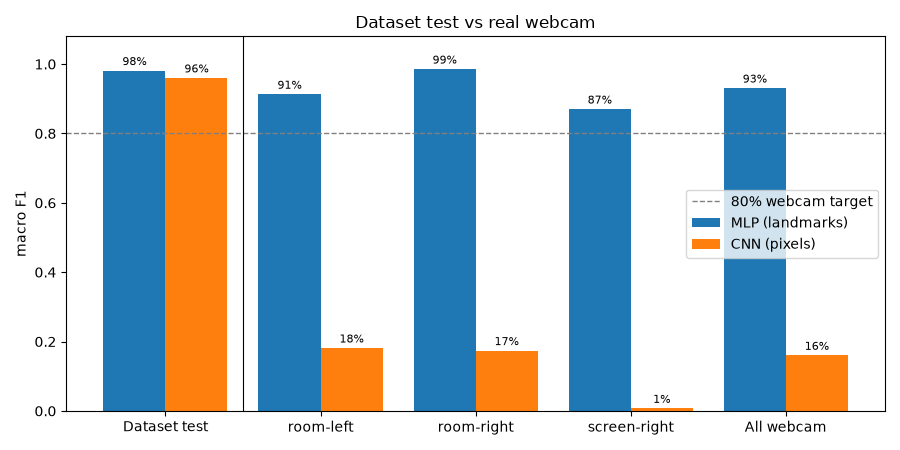
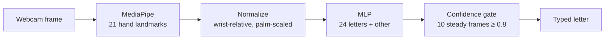

# ASL Fingerspelling Trainer

Real-time ASL fingerspelling practice from a webcam. MediaPipe hand landmarks + an MLP, compared against a CNN baseline on raw images.

CS461 Neural Networks and Deep Learning, final project. A **practice tool, not a translator**: it takes over alphabet drill so instructor time goes to teaching.

## What it does

A web app where you sign letters to your webcam and get instant feedback:

- **Learn**: every letter with a reference photo, a handshape tip and the letters it's easily mixed up with
- **Practice** by category (Alphabet, Everyday, Food, Animals, Colors, Nature, Double letters): spell the word letter by letter, with hints and retries
- **Exam**: no reference photo, scored on letters right the first try
- **Free spell**: sign anything; a pause adds a space
- **My progress**: accuracy per letter, letters to work on, exam history
- **Trainer dashboard**: where a (simulated) class gets stuck and why, plus an instructor-time estimate

Covers the 24 static letters of the ASL alphabet (J and Z need motion).

## Results

| | MLP (landmarks) | CNN (hand images) |
|---|---|---|
| Dataset test, macro F1 | **98.1%** | 96.0% |
| **Real webcam, macro F1** (216 samples, 3 sessions) | **93.1%** | 16.0% |
| Parameters | 52k | 97k |
| Model time per sample | 0.07 ms | 1.43 ms |

On the dataset the two models are 2 points apart; on a real webcam, about 80. The CNN learned the look of the dataset's single room and signer, while landmarks carry no lighting, background or skin information.

- Webcam: room light 98.6%, left hand 91.3%, dark room 87.0% (target was ≥ 80%)
- Processing time: 10.8 ms per frame on a laptop CPU (target ≤ 33 ms)
- Tuning (Adam vs SGD+momentum, batch size, LR schedule, dropout): validation loss 0.1175 → 0.1013

Full numbers, decisions and every experiment: [`results/RESULTS.md`](results/RESULTS.md).



## How it works



MediaPipe runs in the browser; the landmarks go to a FastAPI server that runs the model. The gate turns per-frame guesses into typed letters and handles double letters (slide the hand sideways).

## Run it

Requirements: **Python 3.12**, **Node.js 22+**, a webcam. Tested on Windows 10 with Chrome.

```bash
# Python (from the project root)
py -3.12 -m venv .venv
.venv\Scripts\python -m pip install torch torchvision --index-url https://download.pytorch.org/whl/cpu
.venv\Scripts\python -m pip install -r requirements.txt

# Web app
cd web
npm install
cd ..
```

Then on Windows:

- **`demo.bat`**: builds the app and serves everything at **http://127.0.0.1:8000**
- **`dev.bat`**: development, opens the API and the React dev server; use **http://127.0.0.1:5173**

Use `127.0.0.1`, not `localhost`: on some Windows setups `localhost` adds a 2-second delay to every request.

The trained models are included (`models/mlp_final.pt`, `models/mlp_other_final.pt`, `models/cnn_final.pt`), so the app runs without the dataset.

## Reproduce the experiments

Download the [ASL Alphabet dataset](https://www.kaggle.com/datasets/grassknoted/asl-alphabet) into `data/raw/asl_alphabet_train/` (one folder per letter). With the venv active:

```bash
python -m src.extract                 # landmarks + hand crops (~6 min on 10 CPU cores)
python -m src.train --optimizer adam --batch-size 64 --scheduler plateau --patience 8   # final MLP
python -m src.train --model cnn --optimizer adam --batch-size 64 --scheduler plateau --patience 8   # CNN (~2.5 h on CPU)
python -m src.evaluate                # test set, confusion matrices, saves models/*_final.pt
python -m scripts.record_test --session room-right --hand right   # record a webcam test session
python -m src.evaluate_webcam --details
```

Every training run is logged to `results/runs.csv` with per-epoch curves in `results/history/`. Other scripts in `scripts/` cover the brightening experiment, the "other" class, the simulated class and the checks (`check_gate`, `check_api`, `check_db`, `check_split`, `check_normalize`).

## Project structure

```
src/        pipeline: extraction, normalization, dataset split, models, training, evaluation, gate
scripts/    experiments, recorders, plots and checks
app/        FastAPI server and SQLite attempt log
web/        React app (Vite) with MediaPipe in the browser
models/     final trained models + MediaPipe hand model
results/    RESULTS.md, run logs, evaluation CSVs, figures
docs/       check-in and report outlines
```

## Limitations

- **One signer** for the webcam test; the dataset itself has few signers.
- **The dataset's T isn't standard ASL** (thumb sideways instead of between index and middle). The app keeps it with a visible warning; a real deployment needs T re-recorded.
- The **trainer dashboard's class is simulated**, not real users. Recognition rates in the simulation are measured from the real app; learner behaviour is assumed.
- Adding the "other" class made O read as C more often; a small change of hand angle usually fixes it.
- J, Z and fast continuous spelling would need a sequence model.

## Data

ASL Alphabet dataset by grassknoted on Kaggle (see its page for the license). The app's reference photos in `web/public/letters/` are cropped from it. Hand landmarks by Google's MediaPipe Hand Landmarker.
